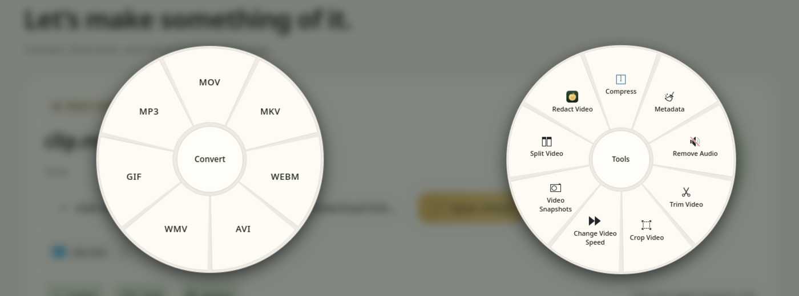
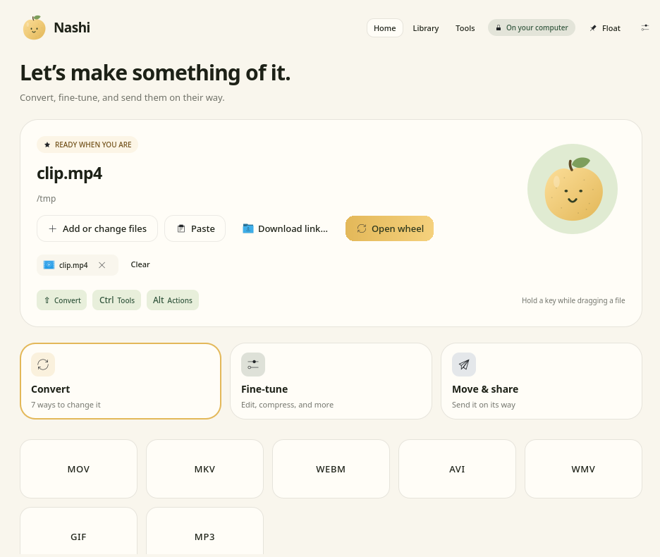
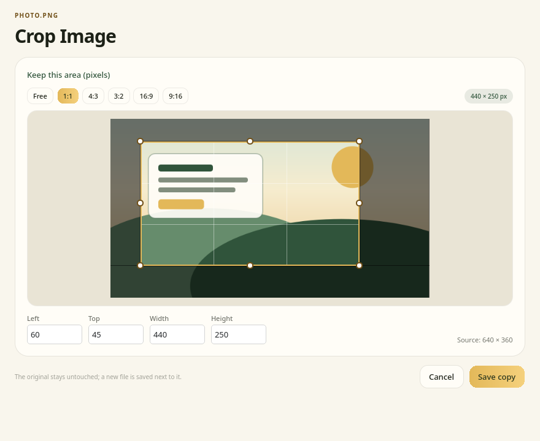
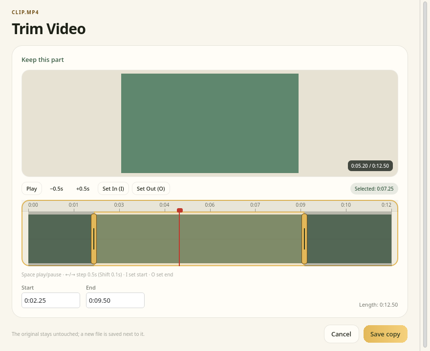
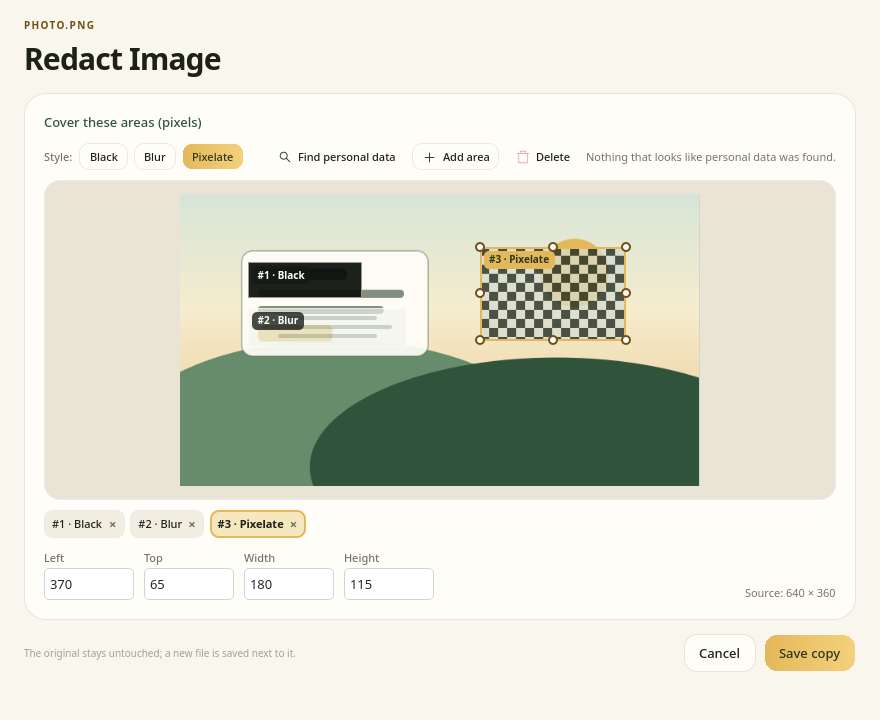
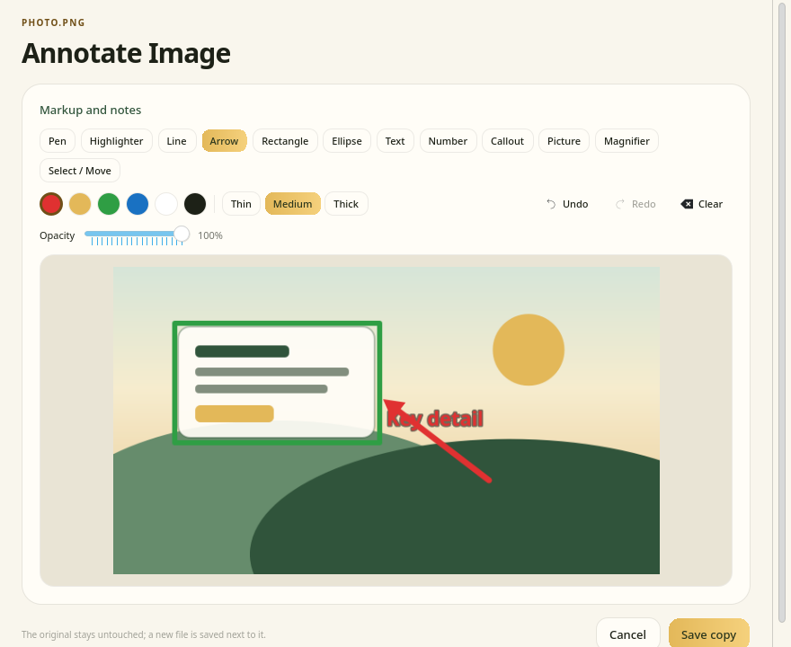

<p align="center"></p>
<h1 align="center">Nashi for Linux</h1>
<p align="center">Your files, a little sweeter. · Dosyaların için tatlı bir kolaylık.</p>

<p align="center"><b>English</b> · <a href="README.tr.md">Türkçe</a> · <a href="#install-arch--cachyos">Install</a> · <a href="https://github.com/orkunisitmak/nashi-app">Upstream (macOS/Windows)</a> · <a href="LICENSE">MIT</a></p>

<p align="center"></p>

Drag a file, press **Shift**, **Ctrl** or **Alt**, and a wheel opens under your cursor. Drop the file on a slice to convert or edit it. The result is written next to the original as a new file, and the original is never touched.

Nashi for Linux is an independent port of [Nashi](https://github.com/orkunisitmak/nashi-app), the open-source macOS and Windows app by Orkun Işıtmak. It is built for KDE Plasma 6 on Wayland and CachyOS. Other desktops are untested.

> **Status:** early release ([v0.1.0](https://github.com/berat-kaan-akcan/nashi/releases/tag/v0.1.0)). Tested in a real KDE Plasma 6 Wayland session on CachyOS. Roadmap: [docs/PLAN.md](docs/PLAN.md) (Turkish).

<p align="center"></p>

## What it does

| Key | Wheel | Examples |
|---|---|---|
| **Shift** | Convert | `video.mov` → MP4, MP3, GIF · `report.docx` → PDF · `photo.heic` → JPG |
| **Ctrl** | Tools | Compress, trim, crop, redact, merge/split PDFs, collage, read QR codes… |
| **Alt** | File actions | Copy, copy path, open folder, open terminal, share |

The keys can be changed in Settings, and **Meta** works too.

**46 formats:**

- Images: JPG, PNG, WebP, HEIC, TIFF, SVG, AVIF, BMP, GIF
- Audio: MP3, M4A, WAV, FLAC, OGG, Opus, AIFF, WMA
- Video: MP4, MOV, MKV, WebM, AVI, WMV
- Documents: PDF, DOCX, Pages, RTF, RTFD, HTML, EPUB, Markdown, TXT
- Spreadsheets and slides: XLSX, XLS, ODS, CSV, TSV, PPT, PPTX
- Subtitles and archives: SRT, VTT, ZIP, TAR, GZ, RAR

Password-protected archives and PDFs ask for their password; it is passed on standard input, never on a command line.

**27 tools:** compression (by target size or percentage), metadata removal and editing, photo adjustments (exposure, contrast, color…), crop, annotate, background and frame, collage, redaction (black box, blur or pixelate, with OCR suggestions for personal data and faces), audio loudness matching, audio trim and bleep-out, video trim / crop / split / merge / speed-up, frame grabs, audio-to-video, PDF merge / split / page organizer, archive extraction, QR reading.

Crop, redact, annotate and timeline tools open an editor first:

| Image crop | Video trim |
| :---: | :---: |
|  |  |
| **Redact** | **Annotate** |
|  |  |

Screenshots are offscreen renders of the real UI (`NASHI_SCREENSHOT_DIR`). The sample files are synthetic; no personal files appear.

Beyond the wheel:

- **Home window:** drop zone, recent outputs (Library) and preview
- **Web download:** video, audio or images from a link (`Ctrl+Shift+D`)
- **Float shelf:** a file shelf pinned to the screen edge
- **Window placement:** `nashi --windows` snaps a window to a half, corner or third (KDE Plasma only)
- **Dolphin and Nautilus** right-click menus, and "Open with → Nashi"
- Turkish, English and French UI, light and dark theme

## Install (Arch / CachyOS)

```sh
git clone https://github.com/berat-kaan-akcan/nashi.git
cd nashi/packaging/arch
makepkg -si
```

This builds the `nashi-git` package from the `main` branch on GitHub. It is not on the AUR yet.

Then add yourself to the `input` group so the drag detector can read input devices, **log out and back in**, and start the service:

```sh
sudo usermod -aG input "$USER"
systemctl --user enable --now nashi-inputd.service
```

Nashi starts in the tray at login. A first-run wizard checks these steps and any missing tools.

### Conversion tools

Conversions run on programs already on your system; Nashi downloads nothing. They are optional: if a tool is missing, the options that need it show as unavailable on the wheel and the app keeps working. The **Tools** page in the app lists what is missing and the install command.

To install everything at once:

```sh
sudo pacman -S --needed ffmpeg imagemagick libheif librsvg libreoffice-fresh libwpg \
  perl-image-exiftool qpdf poppler ghostscript 7zip zbar pandoc-cli yt-dlp curl \
  qt6-multimedia purpose tesseract tesseract-data-tur python-opencv
```

| Program | Used for |
|---|---|
| `ffmpeg` | audio, video and GIF |
| `imagemagick`, `libheif`, `librsvg` | images, HEIC, SVG |
| `libreoffice-fresh`, `libwpg` | documents, spreadsheets, slides, Pages |
| `qpdf`, `poppler`, `ghostscript` | PDF merge, PDF to image/text, compression |
| `perl-image-exiftool` | metadata |
| `7zip` | archives |
| `pandoc-cli` | Markdown and EPUB |
| `zbar` | QR reading |
| `tesseract`, `python-opencv` | personal-data and face suggestions in redaction |
| `yt-dlp`, `curl` | web download |
| `qt6-multimedia` | timeline and playback in previews |
| `purpose` | KDE Share menu |

### Install without a package

```sh
packaging/install.sh            # build, install under /usr/local
packaging/install.sh --user     # install under ~/.local
packaging/install.sh --dry-run  # show what would happen, change nothing
```

More options, uninstalling and the installed files: [packaging/README.md](packaging/README.md) (Turkish).

## Why the `input` group?

On Wayland an app cannot see drags or key presses in other windows. A small service, `nashi-inputd`, therefore reads `/dev/input` directly and reports only the "dragging + modifier key" state to the UI over D-Bus. It never records or forwards key codes or typed text, and it does not grab the devices.

Nashi also works without the service: the drop zone in the main window, the right-click menus and `nashi --wheel FILE` all still work.

## Usage

```sh
nashi                          # open the main window
nashi FILE…                    # open files in the main window
nashi --wheel FILE…            # open the wheel for these files
nashi --wheel --mode tools …   # convert | tools | actions
nashi --windows                # window placement picker
```

The engine behind the UI also works on its own:

```sh
nashi-cli convert pdf report.docx
nashi-cli tool compress video.mp4
nashi-cli wheel photo.heic     # what the wheel would show for this file
nashi-cli deps                 # which tools are installed
```

### Settings

- UI: `~/.config/nashi/nashi.conf` (change it from the Settings page)
- Drag detector: `~/.config/nashi/inputd.toml`

```toml
enabled = true
drag_hold_ms = 120     # wait before a press counts as a drag
drag_move_px = 8       # minimum movement to count as a drag
[chords]
shift = "convert"      # convert | tools | actions | none
ctrl  = "tools"
alt   = "actions"
meta  = "none"
```

Service log: `journalctl --user -u nashi-inputd -f`

## Safety principles

- Input files are never modified, moved or deleted. Shift-dragging in Dolphin means "move", but Nashi always accepts the drop as a copy.
- Output is written to a temporary file first, then moved next to the source under a unique name (`name (1).ext`). A cancelled job leaves no partial file.
- External programs are started with an argument list, never through a shell.
- Only the web download tool touches the network. HTML to PDF conversion strips scripts and remote resources.

## Development

You need Rust (cargo), CMake, Ninja, Qt ≥ 6.5 (`qt6-base`, `qt6-declarative`, `qt6-svg`, `qt6-tools`), optionally `layer-shell-qt`, and `python` for the tests.

```sh
# Rust: engine, CLI, inputd
cargo build --workspace
cargo test --workspace
cargo clippy --workspace --all-targets -- -D warnings

# Qt UI
cmake -S ui -B build/ui -G Ninja
cmake --build build/ui
QT_QPA_PLATFORM=offscreen ctest --test-dir build/ui --output-on-failure

# Try it without installing
NASHI_CLI="$PWD/target/debug/nashi-cli" ./build/ui/nashi
```

Tests that need a missing external tool are skipped, not failed. Without `LayerShellQt` the wheel layer falls back to a frameless full-screen window.

```
crates/nashi-core    catalog, file detection, conversion engines
crates/nashi-cli     command-line front end of the engine (JSON-lines progress)
crates/nashi-inputd  drag + key detector (evdev → D-Bus)
ui/                  Qt 6 / QML app: wheel, main window, editors, tray
packaging/ data/     PKGBUILD, install.sh, .desktop files, Dolphin/Nautilus
docs/                architecture, CLI and D-Bus contracts, plan
```

Before changing code, read [docs/ARCHITECTURE.md](docs/ARCHITECTURE.md), [docs/CLI-PROTOCOL.md](docs/CLI-PROTOCOL.md) and [docs/DBUS.md](docs/DBUS.md). When a contract changes, both sides are updated in the same change.

## Known limits

- Only tested on KDE Plasma 6 Wayland. GNOME, Hyprland and X11 come later.
- Apple Pages files can be read but not written. There is no PDF → XLSX.
- The two-step wheel, used for sources that do not reveal the file type before the drop, has not been tried in a real session.
- The French translation has not been reviewed by a native speaker.

## License and credits

MIT, see [LICENSE](LICENSE).

An independent Linux port inspired by [Nashi](https://github.com/orkunisitmak/nashi-app) (MIT) by Orkun Işıtmak, whose macOS and Windows builds are available there. The conversion catalog, pear artwork, wheel sound and design language come from that project; details are in [NOTICE](NOTICE). This repository contains none of its compiled files.
