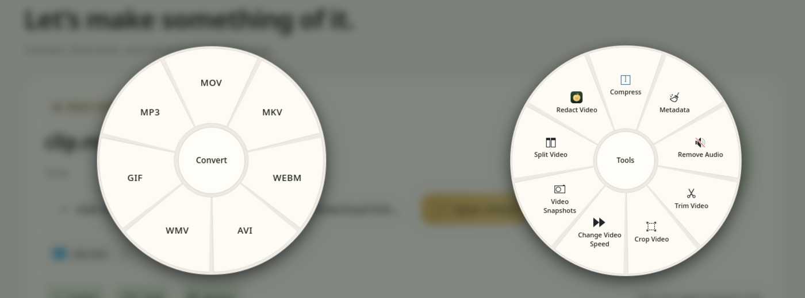
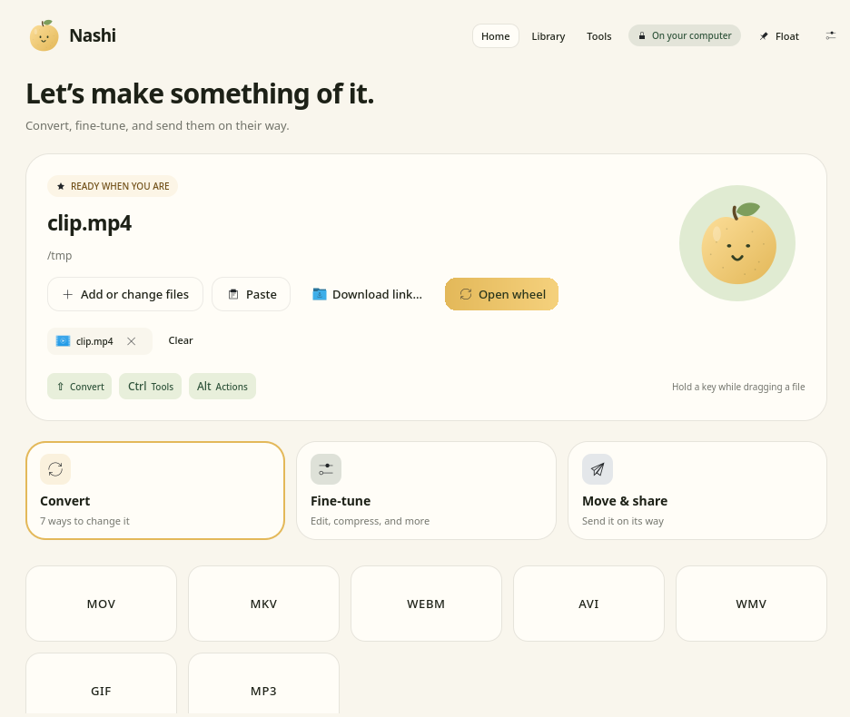
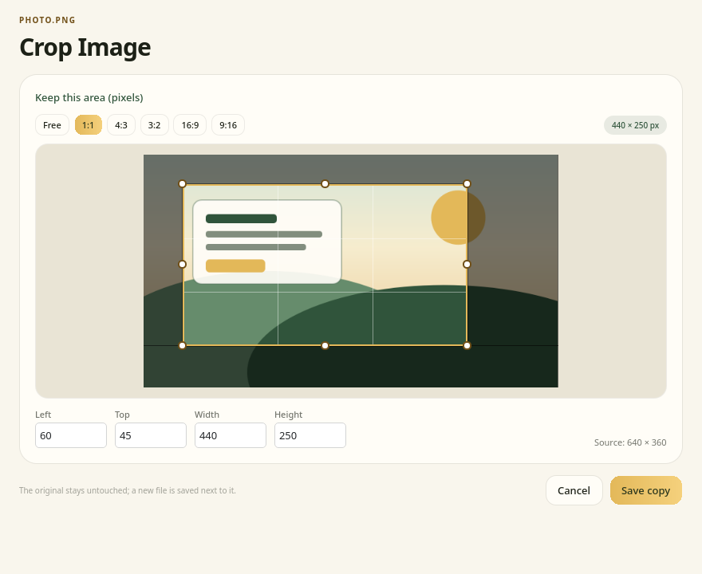
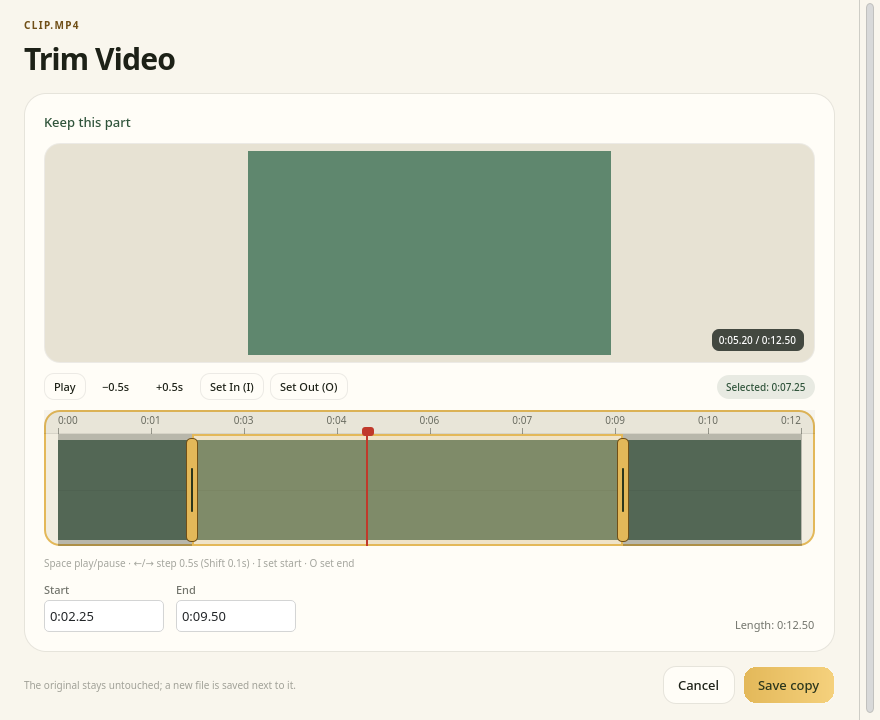
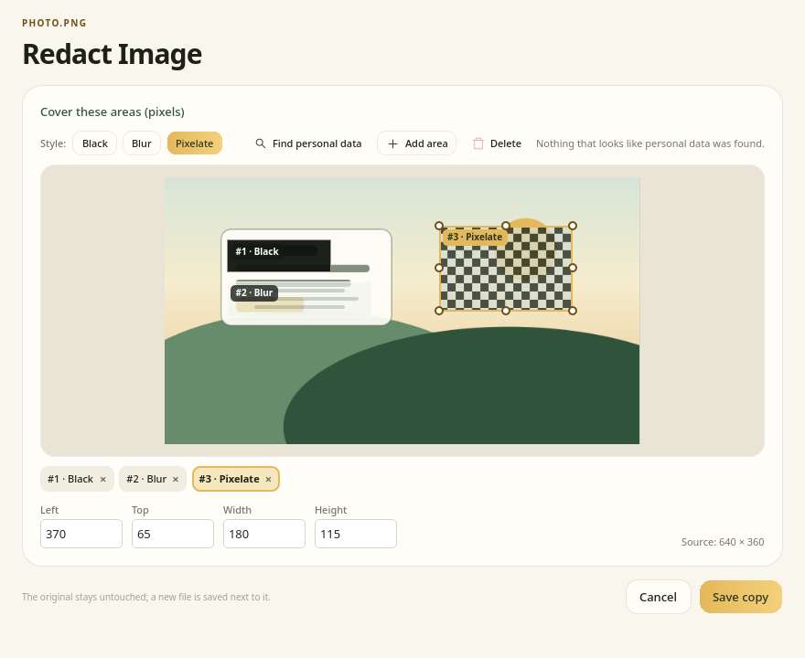
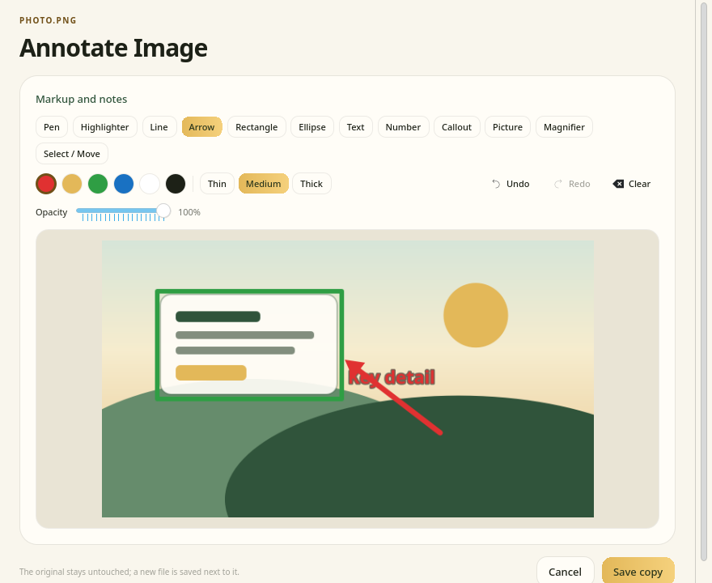

<p align="center"></p>
<h1 align="center">Nashi for Linux</h1>
<p align="center">Dosyaların için tatlı bir kolaylık. · Your files, a little sweeter.</p>

<p align="center"><a href="README.md">English</a> · <b>Türkçe</b> · <a href="#kurulum-arch--cachyos">Kurulum</a> · <a href="https://github.com/orkunisitmak/nashi-app">Upstream (macOS/Windows)</a> · <a href="LICENSE">MIT</a></p>

<p align="center"></p>

Dosyayı sürüklerken **Shift**, **Ctrl** veya **Alt**'a bas; imlecin altında bir çark açılır. Dosyayı bir dilime bırakınca dönüştürülür ya da düzenlenir. Sonuç, kaynak dosyanın yanına yeni bir dosya olarak yazılır. Kaynak dosyaya hiç dokunulmaz.

Orkun Işıtmak'ın macOS ve Windows için yazdığı açık kaynaklı [Nashi](https://github.com/orkunisitmak/nashi-app) uygulamasının bağımsız Linux sürümüdür. KDE Plasma 6 (Wayland) ve CachyOS için yazıldı; diğer masaüstleri henüz denenmedi.

> **Durum:** erken sürüm ([v0.1.0](https://github.com/berat-kaan-akcan/nashi/releases/tag/v0.1.0)). Gerçek bir KDE Plasma 6 Wayland oturumunda denendi. Yol haritası: [docs/PLAN.md](docs/PLAN.md).

<p align="center"></p>

## Ne yapar

| Tuş | Çark | Örnek |
|---|---|---|
| **Shift** | Dönüştür | `video.mov` → MP4, MP3, GIF · `belge.docx` → PDF · `foto.heic` → JPG |
| **Ctrl** | Araçlar | Sıkıştır, kes, kırp, karart, PDF birleştir/böl, kolaj, QR oku… |
| **Alt** | Dosya işlemleri | Kopyala, yolu kopyala, klasörü aç, terminal aç, paylaş |

Tuşların karşılığı Ayarlar'dan değiştirilebilir; **Meta** da kullanılabilir.

**46 format:**

- Görsel: JPG, PNG, WebP, HEIC, TIFF, SVG, AVIF, BMP, GIF
- Ses: MP3, M4A, WAV, FLAC, OGG, Opus, AIFF, WMA
- Video: MP4, MOV, MKV, WebM, AVI, WMV
- Belge: PDF, DOCX, Pages, RTF, RTFD, HTML, EPUB, Markdown, TXT
- Tablo ve sunum: XLSX, XLS, ODS, CSV, TSV, PPT, PPTX
- Altyazı ve arşiv: SRT, VTT, ZIP, TAR, GZ, RAR

Parolalı arşivler ve PDF'ler parolasını sorar; parola komut satırından değil, standart girdiden iletilir.

**27 araç:** sıkıştırma (hedef boyut veya yüzde ile), meta verileri silme ve düzenleme, fotoğraf düzenleme (pozlama, kontrast, renk…), kırpma, not ekleme, arka plan/çerçeve, kolaj, karartma (siyah kutu, bulanık, piksel; OCR ile kişisel veri ve yüz önerisi), ses seviyesi eşitleme, ses kesme ve sansürleme, video kesme/kırpma/bölme/birleştirme/hızlandırma, kare alma, sesten video, PDF birleştirme/bölme/sayfa düzenleme, arşiv açma, QR okuma.

Kırpma, karartma, not ekleme ve zaman çizelgesi gibi araçlar önce bir editör açar:

| Görsel kırpma | Video kesme |
| :---: | :---: |
|  |  |
| **Karartma** | **Not ekleme** |
|  |  |

Görüntüler gerçek arayüzün offscreen çıktılarıdır (`NASHI_SCREENSHOT_DIR`); örnek dosyalar sentetiktir, kişisel dosya yoktur.

Çark dışında:

- **Ana pencere:** bırakma alanı, son çıktılar (Kütüphane) ve önizleme
- **Web indirme:** linkten video, ses veya görsel (`Ctrl+Shift+D`)
- **Float rafı:** ekran kenarında dosya tutma rafı
- **Pencere yerleştirme:** `nashi --windows` ile pencereyi yarıya, köşeye veya üçte bire taşıma (yalnızca KDE Plasma)
- **Dolphin ve Nautilus** sağ tık menüleri, "Birlikte aç → Nashi"
- Türkçe, İngilizce ve Fransızca arayüz, açık ve koyu tema

## Kurulum (Arch / CachyOS)

```sh
git clone https://github.com/berat-kaan-akcan/nashi.git
cd nashi/packaging/arch
makepkg -si
```

Bu, `nashi-git` paketini GitHub'daki `main` dalından derler. AUR'da henüz yok.

Sonra sürükleme algılayıcısının giriş aygıtlarını okuyabilmesi için kendinizi `input` grubuna ekleyin, **oturumu kapatıp yeniden açın** ve servisi başlatın:

```sh
sudo usermod -aG input "$USER"
systemctl --user enable --now nashi-inputd.service
```

Nashi oturum açılışında tepside başlar. İlk açılışta bir sihirbaz bu adımları ve eksik araçları kontrol eder.

### Dönüştürme araçları

Dönüşümler sistemdeki programlarla yapılır; Nashi hiçbir şey indirmez. Bunlar isteğe bağlıdır: eksik olan aracın gerektirdiği seçenek çarkta "kullanılamaz" görünür, uygulama çalışmaya devam eder. Uygulamadaki **Araçlar** sayfası eksikleri ve kurulum komutunu gösterir.

Hepsini birden kurmak için:

```sh
sudo pacman -S --needed ffmpeg imagemagick libheif librsvg libreoffice-fresh libwpg \
  perl-image-exiftool qpdf poppler ghostscript 7zip zbar pandoc-cli yt-dlp curl \
  qt6-multimedia purpose tesseract tesseract-data-tur python-opencv
```

| Program | Ne için |
|---|---|
| `ffmpeg` | ses, video ve GIF |
| `imagemagick`, `libheif`, `librsvg` | görseller, HEIC, SVG |
| `libreoffice-fresh`, `libwpg` | belge, tablo, sunum, Pages |
| `qpdf`, `poppler`, `ghostscript` | PDF birleştirme, görsele/metne çevirme, sıkıştırma |
| `perl-image-exiftool` | meta veriler |
| `7zip` | arşivler |
| `pandoc-cli` | Markdown ve EPUB |
| `zbar` | QR okuma |
| `tesseract`, `python-opencv` | karartmada kişisel veri ve yüz önerisi |
| `yt-dlp`, `curl` | web indirme |
| `qt6-multimedia` | zaman çizelgesi ve önizlemede oynatma |
| `purpose` | KDE Paylaş menüsü |

### Paket olmadan kurulum

```sh
packaging/install.sh            # derle, /usr/local altına kur
packaging/install.sh --user     # ~/.local altına kur
packaging/install.sh --dry-run  # ne yapılacağını göster, hiçbir şeyi değiştirme
```

Diğer seçenekler, kaldırma ve kurulan dosyalar: [packaging/README.md](packaging/README.md).

## Neden `input` grubu?

Wayland'de bir uygulama başka pencerelerdeki sürüklemeyi ve tuşları göremez. Bu yüzden küçük bir servis, `nashi-inputd`, doğrudan `/dev/input` aygıtlarını okur ve yalnızca "sürükleme + değiştirici tuş" durumunu D-Bus ile arayüze bildirir. Tuş kodlarını veya yazdığınız metni kaydetmez, dışarı vermez; aygıtları kilitlemez.

Servis olmadan da Nashi kullanılabilir: ana penceredeki bırakma alanı, sağ tık menüleri ve `nashi --wheel DOSYA` çalışır.

## Kullanım

```sh
nashi                          # ana pencereyi aç
nashi DOSYA…                   # dosyaları ana pencerede aç
nashi --wheel DOSYA…           # çarkı bu dosyalar için aç
nashi --wheel --mode tools …   # convert | tools | actions
nashi --windows                # pencere yerleştirme seçicisi
```

Arayüzün kullandığı motor tek başına da çalışır:

```sh
nashi-cli convert pdf belge.docx
nashi-cli tool compress video.mp4
nashi-cli wheel foto.heic      # bu dosya için çarkta ne görünür
nashi-cli deps                 # hangi araçlar kurulu
```

### Ayarlar

- Arayüz: `~/.config/nashi/nashi.conf` (uygulamadaki Ayarlar sayfasından değiştirin)
- Sürükleme algılayıcı: `~/.config/nashi/inputd.toml`

```toml
enabled = true
drag_hold_ms = 120     # sürükleme sayılmadan önce bekleme
drag_move_px = 8       # sürükleme sayılması için en az hareket
[chords]
shift = "convert"      # convert | tools | actions | none
ctrl  = "tools"
alt   = "actions"
meta  = "none"
```

Servis günlüğü: `journalctl --user -u nashi-inputd -f`

## Güvenlik ilkeleri

- Girdi dosyaları asla değiştirilmez, taşınmaz veya silinmez. Dolphin'de Shift ile sürükleme "taşı" anlamına gelse de Nashi bırakmayı her zaman kopyalama olarak kabul eder.
- Çıktı önce geçici dosyaya yazılır, sonra benzersiz bir adla (`ad (1).uzantı`) kaynağın yanına taşınır. İptal edilen işten yarım dosya kalmaz.
- Dış programlar kabuk üzerinden değil, doğrudan argüman listesiyle çağrılır.
- Ağa yalnızca web indirme aracı çıkar. HTML → PDF dönüşümünde betikler ve uzak kaynaklar atılır.

## Geliştirme

Gerekenler: Rust (cargo), CMake, Ninja, Qt ≥ 6.5 (`qt6-base`, `qt6-declarative`, `qt6-svg`, `qt6-tools`), isteğe bağlı `layer-shell-qt`, testler için `python`.

```sh
# Rust: motor, CLI, inputd
cargo build --workspace
cargo test --workspace
cargo clippy --workspace --all-targets -- -D warnings

# Qt arayüzü
cmake -S ui -B build/ui -G Ninja
cmake --build build/ui
QT_QPA_PLATFORM=offscreen ctest --test-dir build/ui --output-on-failure

# Kurmadan dene
NASHI_CLI="$PWD/target/debug/nashi-cli" ./build/ui/nashi
```

Eksik dış araç gerektiren testler başarısız olmaz, atlanır. `LayerShellQt` yoksa çark katmanı çerçevesiz tam ekran pencereye düşer.

```
crates/nashi-core    katalog, dosya tespiti, dönüştürme motorları
crates/nashi-cli     motoru çalıştıran komut satırı (JSON-lines ilerleme)
crates/nashi-inputd  sürükleme + tuş algılayıcı (evdev → D-Bus)
ui/                  Qt 6 / QML uygulaması: çark, ana pencere, editörler, tepsi
packaging/ data/     PKGBUILD, install.sh, .desktop, Dolphin/Nautilus
docs/                plan, mimari, CLI ve D-Bus sözleşmeleri
```

Kodu değiştirmeden önce [docs/ARCHITECTURE.md](docs/ARCHITECTURE.md), [docs/CLI-PROTOCOL.md](docs/CLI-PROTOCOL.md) ve [docs/DBUS.md](docs/DBUS.md) dosyalarını okuyun. Bir sözleşme değişirse her iki taraf aynı değişiklikte güncellenir.

## Bilinen sınırlar

- Yalnızca KDE Plasma 6 Wayland'de denendi. GNOME, Hyprland ve X11 sonraki aşamada.
- Apple Pages dosyası okunur ama yazılmaz. PDF → XLSX yok.
- Bırakmadan önce dosya türünü vermeyen kaynaklar için iki aşamalı çark gerçek oturumda denenmedi.
- Fransızca çeviriyi henüz anadili Fransızca olan biri okumadı.

## Lisans ve teşekkür

MIT, bkz. [LICENSE](LICENSE).

Orkun Işıtmak'ın macOS ve Windows için yazdığı [Nashi](https://github.com/orkunisitmak/nashi-app) uygulamasından (MIT) esinlenen bağımsız bir Linux sürümüdür. Mac ve Windows sürümü oradan indirilir. Dönüşüm kataloğu, armut çizimleri, çark sesi ve tasarım dili oradan alındı; ayrıntılar [NOTICE](NOTICE) dosyasında. Upstream'e ait derlenmiş dosya içermez.
